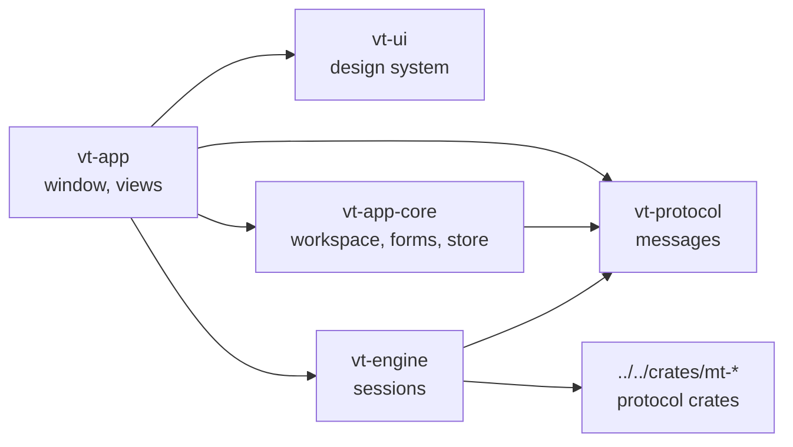
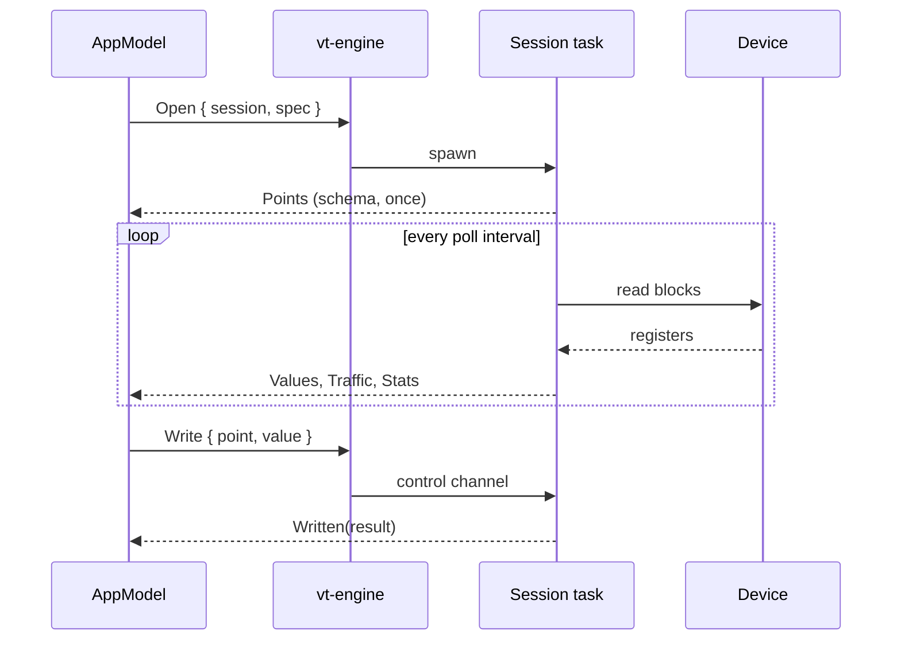

# Architecture

The layering follows [muxy](https://github.com/muxy-app/muxy): the app only
draws and sends commands; sessions run in an engine that talks to devices
through the shared protocol crates.

| Crate | Role | GPUI |
| --- | --- | --- |
| `vt-protocol` | `Command`s to the engine, `Event`s back, session specs. Plain serde data. | no |
| `vt-engine` | One tokio task per session on its own runtime thread. Polls, writes, simulates, reports. | no |
| `vt-app-core` | Saved connections, tabs, split tree, form validation, fuzzy search, atomic storage. | no |
| `vt-ui` | Theme tokens from a colour scheme, metrics, components, text input, charts. No app state. | yes |
| `vt-app` | The binary: one `AppModel` entity, views as functions over it. | yes |

The allowed dependencies are listed in `Cargo.toml`
(`[workspace.metadata.architecture.allowed-dependencies]`); change that table
and this page together.

## A poll, end to end

- The engine owns each session in one task; the app reaches it only through
  the session's control channel, so a slow device never blocks the window.
- The app drains queued events in one batch per wake-up and redraws once.
- Values land in per-point `History` ring buffers (`vt-ui::chart`), shared
  with the charts by `Rc`: painting a frame never copies samples.
- Trends request a new frame only while their session is live. gpui redraws
  a notified view and its ancestors, so the sidebar, tab strip, inspector,
  status bar and each pane are drawn by their own cached views
  (`vt-app/src/views/cached.rs`, after muxy): an animating trend redraws its
  pane and the thin window shell, while everything else replays its last frame
  until the model changes.
- Lists follow new rows only while scrolled to their end; scrolling back to
  read stays put. Each pane keeps its own scroll positions.
- The engine finishes a closing simulator before opening another on the same
  port, and a simulator takes writes from any master into its simulation and
  holds them, reporting `Locked` so the app shows the point as held.
- Each pane records its width at layout (`AppModel::pane_widths`); the
  header, points columns, trend and traffic rows adapt to it on the next
  frame, so a split pane stays readable on a small screen.

## Why the engine speaks messages

`vt-protocol` is the only contract between the window and the sessions, and
every type in it is serde data (tested to round-trip). Today the engine runs
in-process; the same messages can travel over a socket to a background
engine, as muxy's server does for terminals, so polling and simulators keep
running when the window closes and a phone can attach.

## Adding a protocol

1. Add a `SessionSpec` variant and its spec types in `vt-protocol`.
2. Add a session module in `vt-engine` that turns the protocol crate's API into
   `Points`, `Values`, `Traffic`, `Log` and `Written` events.
3. Add a form to `vt-app-core::forms` and its editor in `vt-app`.

The points, trend, traffic and log views work for any protocol that reports
points; protocol-specific views (an OPC UA browse tree, an MQTT topic tree)
go next to them in `vt-app/src/views`.

## Design system

`vt-ui::theme::Theme` derives every token (surfaces, borders, accent, status
colours, six chart series) from one Ghostty-format colour scheme, so all 492
bundled schemes work. `Voltrus` and `Voltrus Light` are the house themes.
Spacing, type and control sizes come from `theme::metrics`; views never use
raw colours or sizes.
