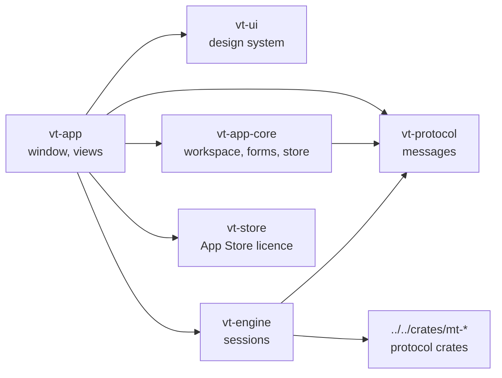
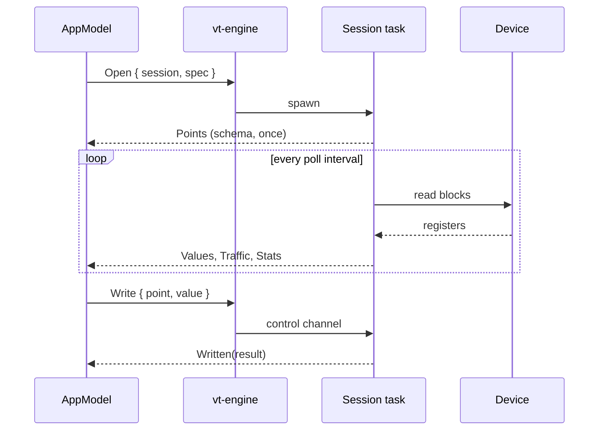

# Architecture

The layering follows [muxy](https://github.com/muxy-app/muxy): the app only
draws and sends commands; sessions run in an engine that talks to devices
through the shared protocol crates.

| Crate | Role | GPUI |
| --- | --- | --- |
| `vt-protocol` | `Command`s to the engine, `Event`s back, session specs. Plain serde data. | no |
| `vt-engine` | One tokio task per session on its own runtime thread. Polls, writes, simulates, reports. | no |
| `vt-app-core` | Saved connections, tabs, split tree, form validation, fuzzy search, atomic storage. | no |
| `vt-ui` | Theme tokens from a colour scheme, metrics, components, text input, charts. No app state. | yes |
| `vt-store` | The Mac App Store trial and unlock: licence state machine, cached entitlements, StoreKit 2 through a Swift bridge (`store` feature). See [release.md](release.md). | no |
| `vt-app` | The binary: one `AppModel` entity, views as functions over it. | yes |

The allowed dependencies are listed in `Cargo.toml`
(`[workspace.metadata.architecture.allowed-dependencies]`); change that table
and this page together.

## A poll, end to end

- The engine owns each session in one task; the app reaches it only through
  the session's control channel, so a slow device never blocks the window.
- The app drains queued events in one batch per wake-up and redraws once.
- Values land in per-point `History` ring buffers (`vt-ui::chart`), shared
  with the charts by `Rc`: painting a frame never copies samples. Each keeps
  the longest trend window (15 min) at the session's reporting rate, between
  1 800 and 45 000 samples, and grows only as samples arrive.
- Trends request a new frame only while their session is live. gpui redraws
  a notified view and its ancestors, so the sidebar, tab strip, inspector,
  status bar and each pane are drawn by their own cached views
  (`vt-app/src/views/cached.rs`, after muxy): an animating trend redraws its
  pane and the thin window shell, while everything else replays its last frame
  until the model changes.
- Lists follow new rows only while scrolled to their end; scrolling back to
  read stays put. Each pane keeps its own scroll positions.
- The engine finishes a closing simulator before opening another on the same
  port, and a simulator takes writes from any master into its simulation and
  holds them, reporting `Locked` so the app shows the point as held.
- Each pane records its width at layout (`AppModel::pane_widths`); the
  header, points columns, trend and traffic rows adapt to it on the next
  frame, so a split pane stays readable on a small screen.

## Why the engine speaks messages

`vt-protocol` is the only contract between the window and the sessions, and
every type in it is serde data (tested to round-trip). Today the engine runs
in-process; the same messages can travel over a socket to a background
engine, as muxy's server does for terminals, so polling and simulators keep
running when the window closes and a phone can attach.

## Adding a protocol

1. Add a `SessionSpec` variant and its spec types in `vt-protocol`.
2. Add a session module in `vt-engine` that turns the protocol crate's API into
   `Points`, `Values`, `Traffic`, `Log` and `Written` events.
3. Add a form to `vt-app-core::forms` (a submodule per protocol, e.g.
   `forms/bacnet.rs`) and its editor in `vt-app` (e.g. `model/bacnet.rs` for
   the fields, `views/editor/bacnet.rs` for the sheet), and map the protocol
   to it in `EditorKind::for_protocol` (the "+" menu lists every protocol that
   has one).

Protocols whose points appear over time (MQTT topics) start with an empty
`Points` and report each new point with `PointsAdded`, which keeps the values
and histories so far; the message behind a value goes in `Payloads` (the
inspector shows it), and `Command::Publish` / `Published` carry free-form
publishes. The MQTT simulator's broker lives in the session task
(`vt-engine/src/mqtt/broker.rs`, on rumqttc's packet codec) because
`mt-mqtt`'s rumqttd-based broker cannot be stopped or rebound in-process.

The points, trend, traffic and log views work for any protocol that reports
points; protocol-specific views (an OPC UA browse tree, an MQTT topic tree)
go next to them in `vt-app/src/views`.

Work that belongs to no session is still a message: the BACnet device picker
sends `Command::DiscoverBacnet` under a fresh id from the session counter, and
the engine answers with one `EventKind::BacnetDevices` under that id, which
the app hands to the open editor instead of a session. The EtherNet/IP picker
does the same with `Command::DiscoverEnip` and `EventKind::EnipDevices`.

Requests that belong to a running session but are no point write go through
its control channel and come back under the session: MQTT's
`Command::Publish` / `Published`, and EtherNet/IP's explicit message,
`Command::CipRequest` / `EventKind::CipReply`, which the inspector's card
(`vt-app/src/views/cip.rs`) sends and shows. The EtherNet/IP adapter
simulator is `mt-enip`'s target (`start_enip_server`) with the plant's values
moved by the session task, plus `answer_list_identity` on the same UDP port
so the picker finds it.

OPC UA keeps its requests in one `Command::Opcua { session, request }` and its
answers in one `EventKind::Opcua`: browse a level, read attributes, monitor
more variables (they join as `PointsAdded`), typed text writes (answered by
`Written`), method arguments and calls. `OpcuaRequest::Endpoints` is the
session-less one, answered under its request id like the BACnet picker. The
address-space browser is a column of the points view of OPC UA client panes
(`vt-app/src/views/opcua.rs`, state in `model/opcua.rs`); the inspector shows
the node picked in it. The plant server simulator is `mt-opcua`'s
`PlantServer`, driven by `vt-engine/src/opcua/plant.rs`; certificates live in
`<data dir>/Voltrus Tools/opcua-pki`.
Commands that belong to a protocol but to no point are messages of their own:
a DNP3 master's station commands (integrity and class polls, time sync,
counter freeze, restarts, and controls with an explicit CROB or mode) go as
`Command::Dnp3` and come back as `EventKind::Dnp3Done`; the outstation's
internal indications arrive as `EventKind::Dnp3Iin` whenever they change. A
DNP3 master names its points up front (`Points`) and adds every other point
the outstation reports with `PointsAdded`, like MQTT topics; point flags map to
`Quality` and their names go in `Payloads` for the inspector.
Work a running session does on request, with an answer that is not a value,
is one command and one event per protocol: a NATS client takes
`Command::Nats { session, request }` (publish with headers, request/reply,
list streams, open a stream, fetch from a consumer) and answers with
`EventKind::Nats` (publishes with `Published`). Each waiting request runs on
its own task beside the subscriptions; a request to a session that is not
running is answered "Not connected" at once. The app keeps the replies and
the JetStream browser per connection (`vt-app/src/model/nats.rs`) and draws
them in the inspector (`vt-app/src/views/nats.rs`). The NATS simulator runs
`mt-nats`'s embedded server in the session task (it stops and rebinds
in-process); its request service is an ordinary client of that server.

MTConnect and FANUC CNC sessions (`vt-engine/src/mtconnect`, `src/focas`) need
no message of their own: everything they report is points, `Payloads` (the
text of text events, conditions and FANUC's status words, sent only when it
changes), `Traffic`, `Stats` and `Log`, and the only request is a point write.
An MTConnect client names its points from the probe and sends `Points` again
after a re-probe (an agent restart); `UNAVAILABLE` is a good reading with no
number, so it does not count as an error to the review gate. A FANUC client
lays its points out from its first snapshot (the axes the CNC reports), and a
write to one of its macro points calls `write_macro`. Neither protocol crate
reports wire frames, so their traffic views describe each exchange. The two
simulators are `mt-mtconnect`'s `AgentSimulator` and `mt-focas`'s
`FocasSimulator`; a point write on them acts on the machine (a forced sample, a
raised condition, cycle start, emergency stop) as the app's other simulators'
writes do. FANUC is labelled Beta in the app (`vt-app/src/model/cnc.rs`)
because `mt-focas` has only been tested against its simulator.

SECS/GEM sessions (`vt-engine/src/secsgem`) are also points, `Payloads`, `Traffic`,
`Stats` and `Log` with a point write as the only request. A host (`GemHost`)
establishes communications, names the status variables and equipment constants
(S1F11, S2F29) and lays its points out from them and the types of the first
read: status variables first, read-only, then equipment constants, writable when
numeric; a write sends S2F15 with an item of the constant's own type and maps a
refused `EAC` to a message. An id the equipment answers with an empty list reads
as bad. Events and alarms arrive on `GemHost::subscribe` and are logged. Unlike
MTConnect and FANUC, `mt-secsgem` reports every message it sends and receives
(`LogEntry`, with one-line SML), so the traffic view shows the real exchange:
`vt-engine/src/secsgem/mod.rs` turns each entry into a `TrafficFrame` named by
stream and function. The simulator is `EquipmentSimulator` (a wafer processing
chamber); its points are controls (process, pause, online, remote, one per alarm),
status variables and equipment constants, and a write acts as an operator at the
tool would. SECS/GEM is labelled Beta in the app (`vt-app/src/model/cnc.rs`) because
`mt-secsgem` has only been tested against its simulator and one open-source
library, and the About sheet says it is an independent implementation of SEMI
standards, not affiliated with or certified by SEMI.

The serial port picker works the same way: it sends `Command::ListSerialPorts`
under a request id every two seconds while the editor is open (so a device
plugged in shows up), and `EventKind::SerialPorts` comes back to the editor.
Serial sessions carry raw bytes as `SerialData` chunks; the app keeps them as
ready-to-draw text and hex rows (`vt-app/src/model/terminal.rs`), and the
terminal (`vt-app/src/views/terminal.rs`) replaces the traffic view for serial
panes. Sends, macros and logging are `Command::SerialSend` and
`Command::SerialLog`; the app encodes text or hex into bytes, so the engine
writes exactly what it is given. The serial device simulator prints on a
pseudo-terminal from `mt-serial` (`pty::VirtualPort`) and links it into the
temporary folder under a stable name, which is what its monitors open.
What a device says about itself, beyond its points, goes in the pane's
**Device** view (`PaneView::Device`, `vt-app/src/views/device.rs`). It is not
in `PaneView::ALL`: the switcher offers it, and ⌘5 opens it, only for
connections whose protocol has one (`model::s7::has_device_view`), and
`views/device.rs` hands each protocol to its own module. An S7 client's is the
PLC view (`views/s7.rs`): the session reads the CPU's identity, mode,
diagnostic buffer and blocks over its own connection after connecting and on
`Command::ReadS7Plc`, between polls, and answers with one `EventKind::S7Plc`
whose parts fail on their own (a CPU may refuse one and serve the rest).

The S7 simulator keeps `mt-s7`'s server image in step with its template
through `S7Server::apply_unless_written`, which moves the simulated tags and
returns the client writes since the last tick under one lock, so a value a
client writes is never overwritten and the point is reported `Locked`.

A BLE scan works the same way, except that it answers more than once:
`Command::ScanBle` gets an `EventKind::BleDevices` every few hundred
milliseconds with the peripherals seen so far, the last one marked `done`.
BLE sessions take `Command::Ble` (read now, write bytes, notifications on or
off, a new decoder) and describe each point's characteristic with
`EventKind::BleGatt`. The session and the scan are written against one
`Central` trait (`vt-engine/src/ble/central.rs`): `system.rs` drives this
computer's radio through `mt-ble`, `simulated.rs` plays a few peripherals
in-process. The demo and the tests use the simulated one, so they take the
session's real paths without Bluetooth hardware.

## Design system

`vt-ui::theme::Theme` derives every token (surfaces, borders, accent, status
colours, six chart series) from one Ghostty-format colour scheme, so all 492
bundled schemes work. `Voltrus` and `Voltrus Light` are the house themes.
Spacing, type and control sizes come from `theme::metrics`; views never use
raw colours or sizes.
